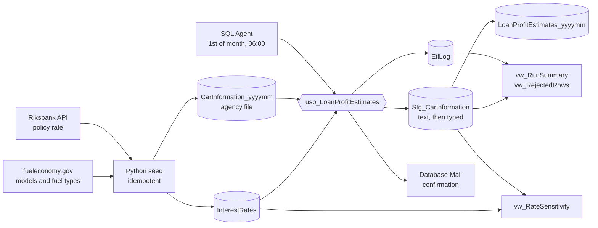

<div align="center">

# What does a Riksbank rate cut cost a car-loan book?

### A monthly T-SQL ETL that prices every vehicle in a loan portfolio from the live policy rate — validated, logged, scheduled by SQL Agent, and tested end to end.

<br/>

[](https://github.com/DavidFarm/loan-profit-etl/actions/workflows/ci.yml)


</div>

---

## The answer

> **Two 25 bp cuts in the Riksbank policy rate took 12.4% off this portfolio's estimated profit** — 2,910k → 2,548k SEK across the same 176 vehicles, 181k SEK per cut.

<div align="center">

<br/><sub>Same vehicles, repriced at each month's real policy rate. Prices and risk tiers are synthetic; rates and vehicle models are real.</sub>
</div>

<br/>

The chart is a view (`vw_RateSensitivity`) on top of the same tables the monthly job produces, using the same formula, so it is a by-product of the pipeline, not a separate analysis.

---

## What it does

A bank receives a vehicle file from an agency every month. Estimated loan profit per vehicle depends on the energy class, a floating base rate that changes monthly, and the bank's margin on top. An analyst used to run these queries by hand.

Now the analyst runs one line:

```sql
SELECT * FROM LoanProfitEstimates_202610;
```

`EstimatedProfit = BasePrice × (BaseInterestRate + BankMargin) / 100`, with margins of 1.0% (electric), 1.5% (hybrid) and 2.5% (gasoline/diesel).

<div align="center">

</div>

---

## Architecture



### Engineering decisions worth a closer look

| Decision | Why |
|---|---|
| **Text staging, typed columns beside it** | A bad value in the agency file can never fail the load itself. It gets cleaned (`TRIM`, `TRY_CONVERT`, decimal commas) or rejected with a reason. |
| **First failing rule wins, rejects stay visible** | Rejected rows are kept in staging with a `RejectReason`, summarised in the log and exposed through `vw_RejectedRows`. |
| **Output rebuilt in one transaction** | `DROP` + `SELECT INTO` + primary key in a transaction with `XACT_ABORT ON`. The analyst never sees a half-built table, and a failed run leaves last month's result intact. |
| **Rate fallback is a logged warning, not a silent guess** | If the current month has no rate, the most recent earlier month is used and the run says so, including which month and value. No rate at all is a hard stop. |
| **Mail failure never fails the job** | The confirmation mail is sent after the main `TRY/CATCH` and has its own handler. A broken mail server is logged as a warning; the data is still correct. |
| **Dynamic table names done safely** | `CarInformation_yyyymm` and `LoanProfitEstimates_yyyymm` are built with `QUOTENAME` and `sp_executesql` with parameters. |
| **Failures are loud where it counts** | The procedure re-throws after logging and mailing, so SQL Agent shows the job as failed. |
| **Every script is re-runnable** | `CREATE OR ALTER`, `IF NOT EXISTS`, `DROP ... IF EXISTS`. Running the pipeline twice gives the same result, which a test checks. |

---

## Proof

**Eight end-to-end tests** run the real procedure against SQL Server, each on its own small file with known values:

| Test | What it proves |
|---|---|
| Rate present | A normal month loads clean rows with no fallback warning. |
| Rate missing | The previous month's rate is used and the exact warning is logged. |
| Formula | `EstimatedProfit` matches the formula to the öre for every loaded row. |
| Normalisation | `" electric "` (padded, lower case) becomes `Electric` with its 1.0% margin. |
| Rejects | Five bad rows, one per rule, rejected with the right reasons and counted in the log. |
| Idempotency | A second run gives the same rows and no duplicates. |
| Missing source table | `CarInformation_yyyymm ... not found` is logged and the run fails loudly, with no output table created. |
| Mail failure | A broken mail profile is a logged warning, not a failed run. |

```
pytest tests -v   ->   8 passed
```

GitHub Actions runs the same suite on every push against a SQL Server 2022 container. Server-level pieces (Database Mail, the Agent job) are verified on the local server rather than in CI.

<div align="center">

<br/><sub>One row per run, and every rejected row with its reason. Four bad rows are planted in each monthly file; all four are caught.</sub>
</div>

<br/>

<div align="center">

<br/><sub>The confirmation mail: outcome, rows processed, output table. Captured by a local SMTP sink, so nothing leaves the machine during development.</sub>
</div>

---

## Run it yourself

Requires SQL Server (Developer/Standard, for SQL Agent and Database Mail), Python 3.11 and the ODBC driver.

```powershell
python -m venv .venv ; .venv\Scripts\pip install -r requirements-dev.txt

# 1. Database objects, in order (all re-runnable)
sqlcmd -S localhost -E -b -I -i sql\00_create_database.sql
sqlcmd -S localhost -E -b -I -i sql\01_setup_database_mail.sql   # local SMTP sink on :2525
sqlcmd -S localhost -E -b -I -i sql\02_create_tables.sql
sqlcmd -S localhost -E -b -I -i sql\03_usp_LoanProfitEstimates.sql
sqlcmd -S localhost -E -b -I -i sql\04_agent_job.sql
sqlcmd -S localhost -E -b -I -i sql\05_vw_DataQuality.sql
sqlcmd -S localhost -E -b -I -i sql\06_vw_RateSensitivity.sql

# 2. Source data: Riksbank rates, lookups and two monthly agency files
.venv\Scripts\python.exe python\seed_tables.py

# 3. Optional: catch the confirmation mail locally, then run the job
.venv\Scripts\python.exe python\smtp_sink.py
sqlcmd -S localhost -E -d LoanETL -Q "EXEC dbo.usp_LoanProfitEstimates"

# 4. Tests
.venv\Scripts\python.exe -m pytest tests -v
```

Try the failure paths: `python python\seed_tables.py --skip-rate 202610` leaves the current month without a rate to trigger the fallback, and `EXEC dbo.usp_LoanProfitEstimates @RunMonth = '2026-08-01'` points at a month with no file.

---

## Data

| Data | Source | Real? |
|---|---|---|
| Base interest rate | [Riksbank open API](https://api.riksbank.se/swea/v1), series `SECBREPOEFF` (policy rate), one value per month | Real |
| Vehicle models, years, fuel types | [fueleconomy.gov](https://www.fueleconomy.gov/feg/download.shtml) `vehicles.csv`, mapped to Electric / Hybrid / Gasoline / Diesel | Real |
| Base prices, customer risk tiers | Generated with a fixed random seed | Synthetic |
| Bank margins | From the brief | Given |

No real customer or bank data is used anywhere.

## Scope

This started as an ETL assignment on the Data Engineer programme at Nackademin: build a monthly SQL Server job that ingests a vehicle file, applies the pricing rules and produces a result table, with logging and a confirmation mail. The brief gave no source data, so the data layer, the data-quality and rate-sensitivity views, the tests and CI are my additions.

`CreditRiskTier` and `DepreciationRates` are in the data model from the brief's diagram, but the specified profit formula does not use them. They are loaded and the risk tier is carried through to the output, but they do not affect the calculation.

## Project layout

```
sql/        numbered, re-runnable scripts: database, mail, tables, procedure, Agent job, views
python/     seed_tables.py (source data), smtp_sink.py (local mail), make_charts.py, make_proof.py
tests/      end-to-end tests against SQL Server
docs/       charts, proof images, presentation
marketing/  slide sources (HTML)
```

## About

Built by **David Färm**, Data Engineer student at Nackademin. More projects at [github.com/DavidFarm](https://github.com/DavidFarm).
Slides: [docs/LoanETL_presentation.pdf](docs/LoanETL_presentation.pdf)

[MIT License](LICENSE)
