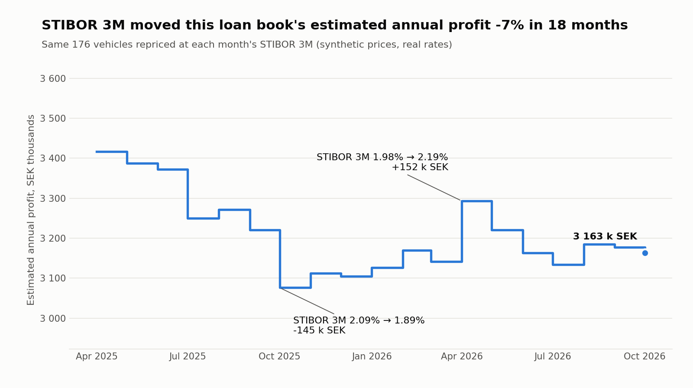
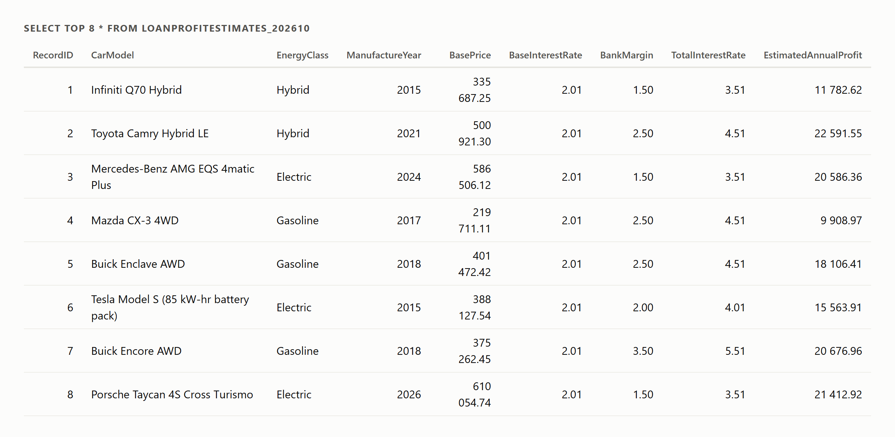
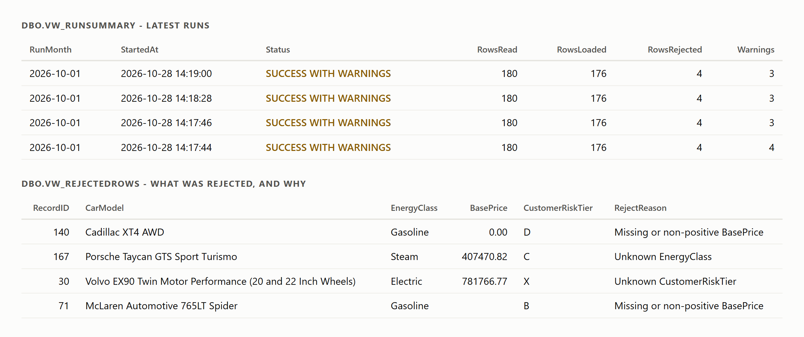
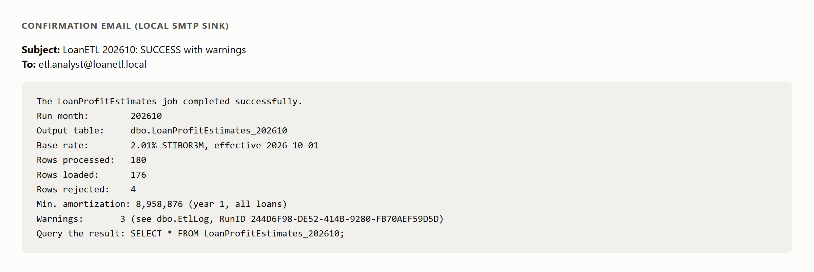

<div align="center">

# What does a STIBOR move cost a car-loan book?

### A monthly T-SQL ETL that prices every vehicle in a loan portfolio from STIBOR 3M — validated, logged, scheduled by SQL Agent, and tested end to end.

<br/>

<table>
  <tr>
    <td align="center" width="130"><br/><sub><b>SQL Server 2022</b><br/>T-SQL · SQL Agent</sub></td>
    <td align="center" width="130"><br/><sub><b>Python 3.11</b><br/>seeding · charts</sub></td>
    <td align="center" width="130"><br/><sub><b>pytest</b><br/>10 end-to-end tests</sub></td>
    <td align="center" width="130"><br/><sub><b>GitHub Actions</b><br/>CI</sub></td>
  </tr>
</table>

[](https://github.com/DavidFarm/loan-profit-etl/actions/workflows/ci.yml)

</div>

---

## The answer

> **STIBOR 3M moved this portfolio's estimated annual profit −7.4% over 18 months** — 3,416k → 3,163k SEK across the same 176 vehicles. The biggest single month was +152k SEK (April 2026, 1.98% → 2.19%).

<div align="center">

<br/><sub>Same vehicles, repriced at each month's STIBOR 3M. Prices and risk tiers are synthetic; rates and vehicle models are real.</sub>
</div>

<br/>

The chart is a view (`vw_RateSensitivity`) on top of the same tables the monthly job produces, using the same formula, so it is a by-product of the pipeline, not a separate analysis.

---

## What it does

A bank receives a vehicle file from an agency every month. Estimated loan profit per vehicle depends on the energy class, a floating base rate that changes monthly, and the bank's margin on top. An analyst used to run these queries by hand.

Now the analyst runs one line:

```sql
SELECT * FROM LoanProfitEstimates_202610;
```

```
BankMargin            = EnergyMargin + RiskAdjustment
TotalInterestRate     = BaseInterestRate + BankMargin
EstimatedAnnualProfit = BasePrice × TotalInterestRate / 100
```

- **BaseInterestRate** is STIBOR 3M, the fixing from the last day of the previous month (the latest one available when the job runs on the 1st).
- **EnergyMargin** is 1.0% (electric), 1.5% (hybrid) and 2.5% (gasoline/diesel), from the brief.
- **RiskAdjustment** is 0.0 / 0.5 / 1.0 / 2.0 percentage points for risk tier A / B / C / D. The brief's formula names only the energy margin; the credit risk tier is priced here on purpose.
- **BasePrice** is today's purchase price of the car, which is also the amount financed (100%).

The output also shows the car's depreciation: `CarAge`, `DepreciationRate` (annual, by age band), `DepreciatedValue` (value after the coming year), `MinAnnualAmortization` (the payoff that keeps the loan at or below that value) and `CustomerAnnualPayment` (year-1 interest + that amortization).

<div align="center">

</div>

---

## Architecture


### Engineering decisions worth a closer look

| Decision | Why |
|---|---|
| **Text staging, typed columns beside it** | A bad value in the agency file can never fail the load itself. It gets cleaned (`TRIM`, `TRY_CONVERT`, decimal commas) or rejected with a reason. |
| **First failing rule wins, rejects stay visible** | Rejected rows are kept in staging with a `RejectReason`, summarised in the log and exposed through `vw_RejectedRows`. |
| **Output rebuilt in one transaction** | `DROP` + `SELECT INTO` + primary key in a transaction with `XACT_ABORT ON`. The analyst never sees a half-built table, and a failed run leaves last month's result intact. |
| **Rate fallback is a logged warning, not a silent guess** | If the current month has no rate, the most recent earlier month is used and the run says so, including which month and value. No rate at all is a hard stop. |
| **Mail failure never fails the job** | The confirmation mail is sent after the main `TRY/CATCH` and has its own handler. A broken mail server is logged as a warning; the data is still correct. |
| **Dynamic table names done safely** | `CarInformation_yyyymm` and `LoanProfitEstimates_yyyymm` are built with `QUOTENAME` and `sp_executesql` with parameters. |
| **Failures are loud where it counts** | The procedure re-throws after logging and mailing, so SQL Agent shows the job as failed. |
| **Every script is re-runnable** | `CREATE OR ALTER`, `IF NOT EXISTS`, `DROP ... IF EXISTS`. Running the pipeline twice gives the same result, which a test checks. |

---

## Proof

**Ten end-to-end tests** run the real procedure against SQL Server, each on its own small file with known values:

| Test | What it proves |
|---|---|
| Rate present | A normal month loads clean rows with no fallback warning. |
| Rate missing | The previous month's rate is used and the exact warning is logged. |
| Formula | `EstimatedAnnualProfit` matches the formula to the öre for every loaded row. |
| Normalisation | `" electric "` (padded, lower case) becomes `Electric` with its 1.0% margin. |
| Risk-adjusted margin | A diesel car in tier D gets 2.5 + 2.0 = 4.5% margin and a 7.5% total rate at a 3% base. |
| Depreciation | Amortization per age band is as expected, depreciated value + amortization = price, and the year-1 payment = interest + amortization. |
| Rejects | Five bad rows, one per rule, rejected with the right reasons and counted in the log. |
| Idempotency | A second run gives the same rows and no duplicates. |
| Missing source table | `CarInformation_yyyymm ... not found` is logged and the run fails loudly, with no output table created. |
| Mail failure | A broken mail profile is a logged warning, not a failed run. |

```
pytest tests -v   ->   10 passed
```

GitHub Actions runs the same suite on every push against a SQL Server 2022 container. Server-level pieces (Database Mail, the Agent job) are verified on the local server rather than in CI.

<div align="center">

<br/><sub>One row per run, and every rejected row with its reason. Four bad rows are planted in each monthly file; all four are caught.</sub>
</div>

<br/>

<div align="center">

<br/><sub>The confirmation mail: outcome, rows processed, output table. Captured by a local SMTP sink, so nothing leaves the machine during development.</sub>
</div>

---

## Run it yourself

Requires SQL Server (Developer/Standard, for SQL Agent and Database Mail), Python 3.11 and the ODBC driver.

```powershell
python -m venv .venv ; .venv\Scripts\pip install -r requirements-dev.txt

# 1. Database objects, in order (all re-runnable)
sqlcmd -S localhost -E -b -I -i sql\00_create_database.sql
sqlcmd -S localhost -E -b -I -i sql\01_setup_database_mail.sql   # local SMTP sink on :2525
sqlcmd -S localhost -E -b -I -i sql\02_create_tables.sql
sqlcmd -S localhost -E -b -I -i sql\03_usp_LoanProfitEstimates.sql
sqlcmd -S localhost -E -b -I -i sql\04_agent_job.sql
sqlcmd -S localhost -E -b -I -i sql\05_vw_DataQuality.sql
sqlcmd -S localhost -E -b -I -i sql\06_vw_RateSensitivity.sql

# 2. Source data: STIBOR 3M, lookups and two monthly agency files
#    Save the SFBF "Summary Statistics" workbook from swfbf.se/stibor/rates as data\STIBOR*.xlsx first.
#    Without it the seed falls back to the Riksbank SSVX 3M rate (RateSource = 'SSVX3M'); CI uses --rate-source ssvx.
.venv\Scripts\python.exe python\seed_tables.py

# 3. Optional: catch the confirmation mail locally, then run the job
.venv\Scripts\python.exe python\smtp_sink.py
sqlcmd -S localhost -E -d LoanETL -Q "EXEC dbo.usp_LoanProfitEstimates"

# 4. Tests
.venv\Scripts\python.exe -m pytest tests -v
```

Optional, real mail instead of the local sink: run `sql\01b_setup_live_mail.sql` yourself with a Gmail app password (usage is in the script header). It adds the profile `LoanETL_Live` and makes the Agent job mail the recipient you give; development runs and tests keep using the local sink.

Try the failure paths: `python python\seed_tables.py --skip-rate 202610` leaves the current month without a rate to trigger the fallback, and `EXEC dbo.usp_LoanProfitEstimates @RunMonth = '2026-08-01'` points at a month with no file.

### Credit Desk workbook (optional, Windows + desktop Excel)

`python\make_credit_desk.py` builds `excel\LoanETL_CreditDesk.xlsx`, a small front end that shows how a credit manager would walk a customer through one of the ETL's cars. It is an educational demo and stores nothing.

- **Loan Application**: pick a car from the database, then set down payment, LTV cap, term, fees, inflation and income. Read-only cells show the policy minimums and the minimum amortization; an indicative assessment and a reconciliation against `LoanProfitEstimates_yyyymm` sit alongside.
- **Prognosis**: 15 years (years 10-14 grouped) of car value after depreciation, loan balance, interest, amortization, cash flow and LTV.
- **Scenarios**: index shifted -5 to +5 pp, and a rate x inflation matrix in today's SEK.

Data arrives through Power Query (Data > Refresh All); every calculation is a normal Excel formula. Power Query connects by machine name because it insists on a certificate-matching server name (`localhost` fails); set `PQ_SERVER` to override. `python\make_credit_desk.py --check` drives the workbook through COM and asserts it reproduces the ETL's rate, year-1 profit and minimum amortization from SQL. The file is git-ignored because it embeds the STIBOR rows.

---

## Data

| Data | Source | Real? |
|---|---|---|
| Base interest rate | STIBOR 3M from the [SFBF](https://swfbf.se/stibor/rates/) summary-statistics export (fixing on the last day of the previous month, rounded to 2 decimals). Fallback: Riksbank SSVX 3M, labelled `SSVX3M` | Real |
| Vehicle models, years, fuel types | [fueleconomy.gov](https://www.fueleconomy.gov/feg/download.shtml) `vehicles.csv`, mapped to Electric / Hybrid / Gasoline / Diesel | Real |
| Base prices, customer risk tiers | Generated with a fixed random seed | Synthetic |
| Bank margins | Energy class margins from the brief; risk adjustments and depreciation rates are assumptions of this project | Given / assumed |

The SFBF data is not committed (`data/` is git-ignored); SFBF's page blocks scripts, so the workbook is downloaded by hand.

No real customer or bank data is used anywhere.

## Scope

This started as an ETL assignment on the Data Engineer programme at Nackademin: build a monthly SQL Server job that ingests a vehicle file, applies the pricing rules and produces a result table, with logging and a confirmation mail. The brief gave no source data, so the data layer, the data-quality and rate-sensitivity views, the tests and CI are my additions.

### Model scope and limitations

This is a simple pricing model, not a credit decision system:

- **Annual, year 1.** Profit is simple interest for one year on the full price, with the rate assumed flat for 12 months (no quarterly resets or compounding). It is an upper bound, since a real loan amortizes.
- **100% financing.** No down payment, loan term or annuity schedule. `MinAnnualAmortization` is only the payoff that keeps the loan at or below the car's depreciated value.
- **Depreciation does not change the margin.** The margin depends on energy class and credit risk tier only; collateral value (loan-to-value) is not priced.
- **"Profit" is gross interest income**, as in the brief. Funding cost, expected credit loss and operating cost are not deducted.
- **Rates are rounded to 2 decimals** (`DECIMAL(5,2)`), so STIBOR 2.007% is stored as 2.01%.

A lender would add a down payment (typically around 20%), a term, expected loss (probability of default × loss given default × exposure), a risk-based margin that reacts to loan-to-value, and funding cost.

## Licences and attribution

The code in this repository is under the [MIT License](LICENSE). The data and third-party material below are **not** covered by it and keep their own terms.

| Material | Owner / source | Terms |
|---|---|---|
| STIBOR 3M | © Swedish Financial Benchmark Facility (SFBF), downloaded from [swfbf.se/stibor/rates](https://swfbf.se/stibor/rates/) | Used under SFBF's **non-commercial, educational licence**, for this coursework only. SFBF provides the data "as is" and it must not be relied on as accurate, timely or fit for a particular purpose. The workbook is not in this repository (`data/` is git-ignored). The chart and `docs/rate_sensitivity.json` show derived monthly values for illustration; anyone reusing them must follow SFBF's terms. |
| SSVX 3M (fallback) | Sveriges Riksbank open API (`SETB3MBENCH`) | Fetched when the SFBF file is missing (and in CI); not stored in the repository. See the Riksbank's terms for the API. |
| Vehicle models, years, fuel types | [fueleconomy.gov](https://www.fueleconomy.gov/feg/download.shtml), published by the U.S. Department of Energy and EPA (administered by Oak Ridge National Laboratory) | Downloaded when seeding, not stored in the repository. The download page states no explicit licence; check the site's policies before redistributing the file. |
| Python libraries | `requests` (Apache-2.0), `pyodbc` (MIT), `openpyxl` (MIT), `aiosmtpd` (Apache-2.0), `pywin32` (PSF), `pytest` (MIT), `matplotlib` (Matplotlib licence, BSD-style) | Installed from PyPI, not redistributed. |
| Technology icons in the header | [Devicon](https://devicon.dev) (MIT), loaded from jsDelivr | The logos belong to their respective owners. |
| Lato font in the slides | Łukasz Dziedzic, SIL Open Font License 1.1, loaded from Google Fonts | Slides only. |
| Course brief | Nackademin | Not published here. |

## Project layout

```
sql/        numbered, re-runnable scripts: database, mail, tables, procedure, Agent job, views
python/     seed_tables.py (source data), smtp_sink.py (local mail), make_charts.py, make_proof.py, make_credit_desk.py (Excel front end)
tests/      end-to-end tests against SQL Server
docs/       charts, proof images, presentation
marketing/  slide sources (HTML)
```

## About

Built by **David Färm**, Data Engineer student at Nackademin. More projects at [github.com/DavidFarm](https://github.com/DavidFarm).
Slides: [docs/LoanETL_presentation.pdf](docs/LoanETL_presentation.pdf)

[MIT License](LICENSE)
